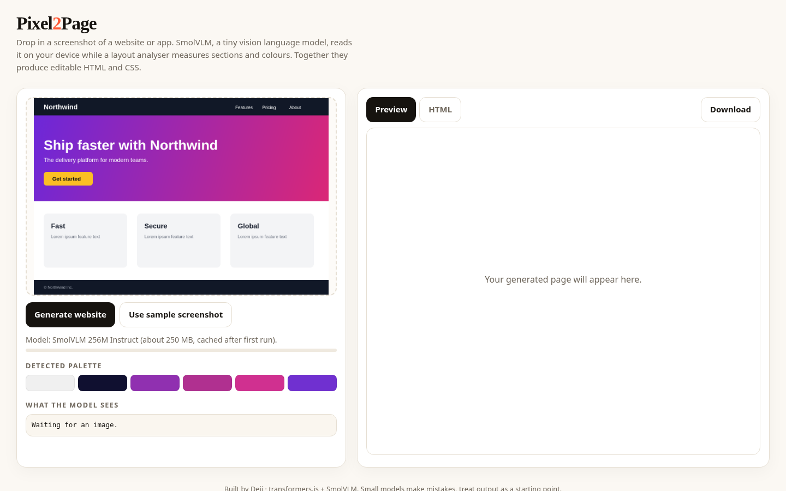

# Pixel2Page

Turn a UI screenshot into a starter website. SmolVLM, a tiny vision language model, reads the image on your device while a layout analyser measures sections and colours. The result is editable HTML and CSS with a live preview.

**Live:** https://josephbepocode.github.io/screenshot-to-site/

## Features
- SmolVLM 256M Instruct via transformers.js (WebGPU or WASM)
- Canvas-based palette extraction and section detection
- Live sandboxed preview, code view and download
- Built-in sample screenshot

## Notes
Images never leave your device. Small models make mistakes, so treat the output as a starting point.

## Run locally
It is a static site. Serve the folder with any static server, for example `python3 -m http.server`, and open `http://localhost:8000`.

No backend, no API keys. Built by Deji.
